# Pylerium


**Free public beta · Windows source release**

This copy starts with a fresh workspace. It includes no personal projects, recordings, account credentials or imported model library. See [Release contents](RELEASE_NOTES.md).
Disclaimer: Pylerium is an original open-source developer workbench bringing the aesthetic of Call of Duty UI. It contains no proprietary game assets, extracted code, or trademarked material from Activision, Treyarch, or the Call of Duty franchise.
A local Python workspace for projects, plugins, reusable GUI components, model inspection, process orchestration and searchable activity history.
### Lobby

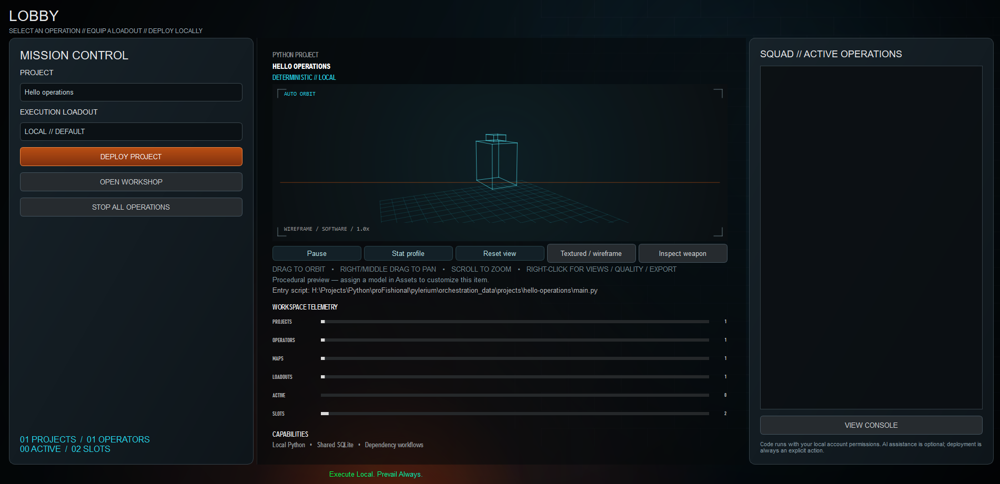

### Loadouts

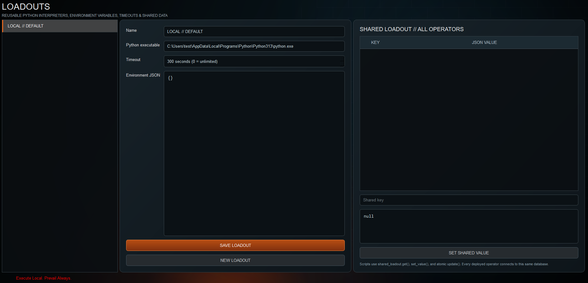

### Operators

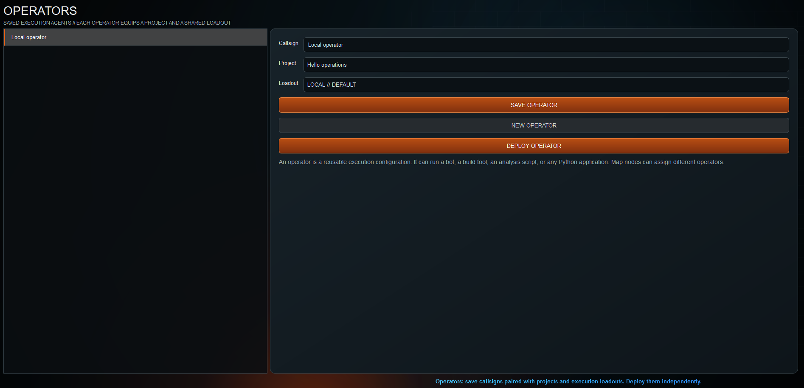

### Maps

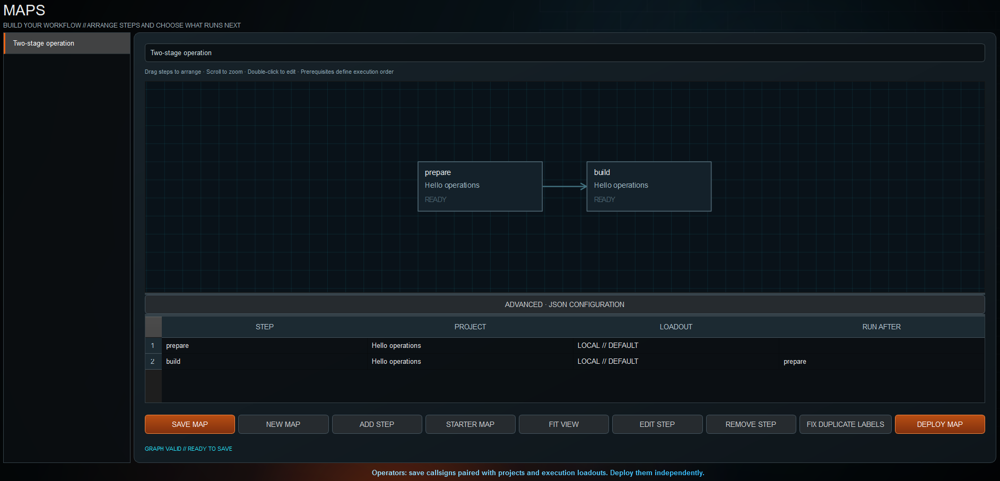

### Missions

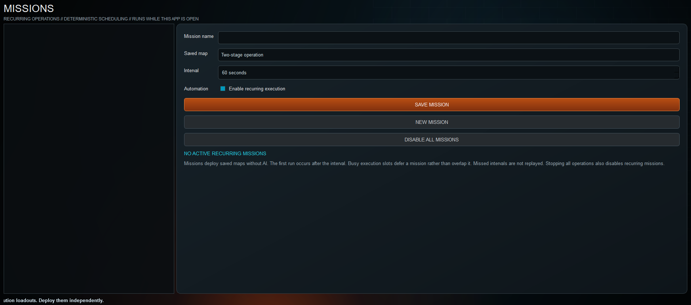

### Arsenal

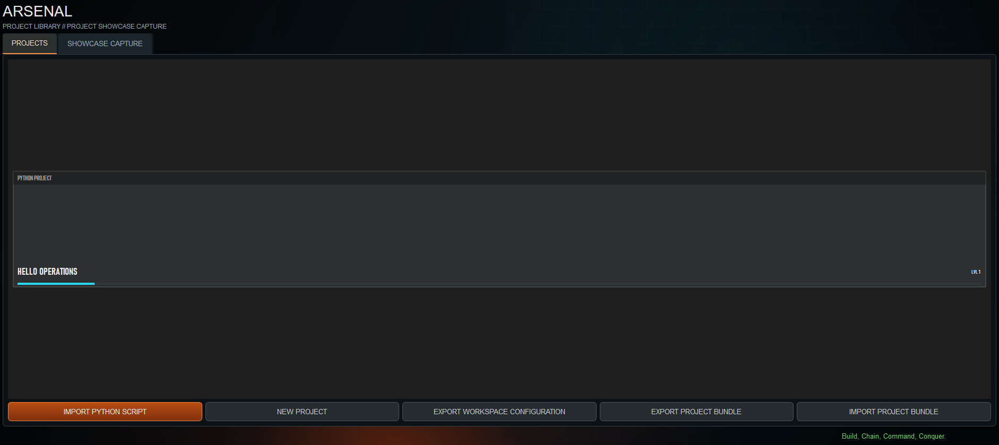

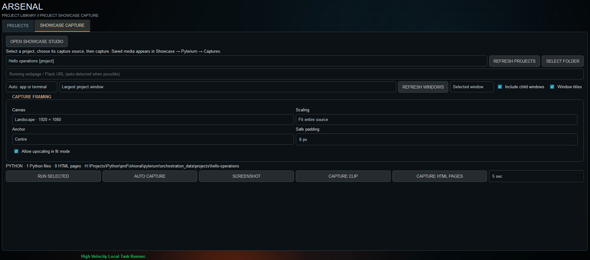

### Workshop

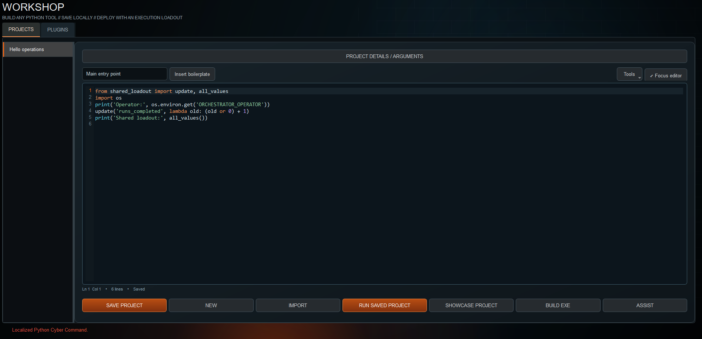

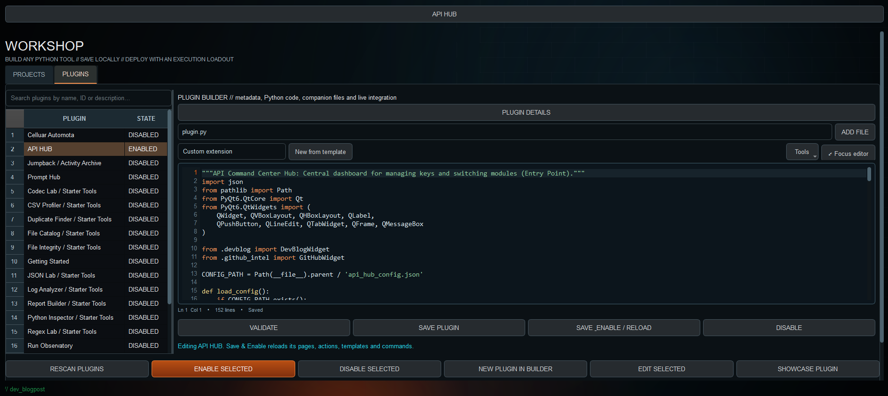

### Console

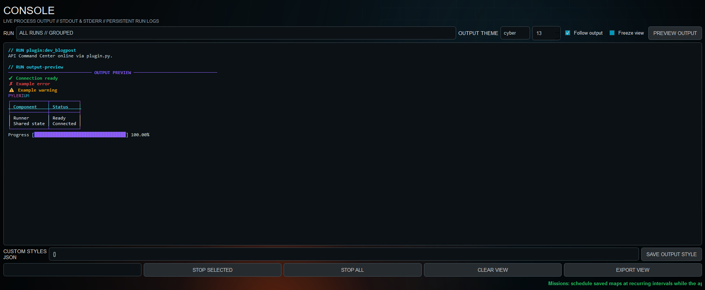

### Barracks

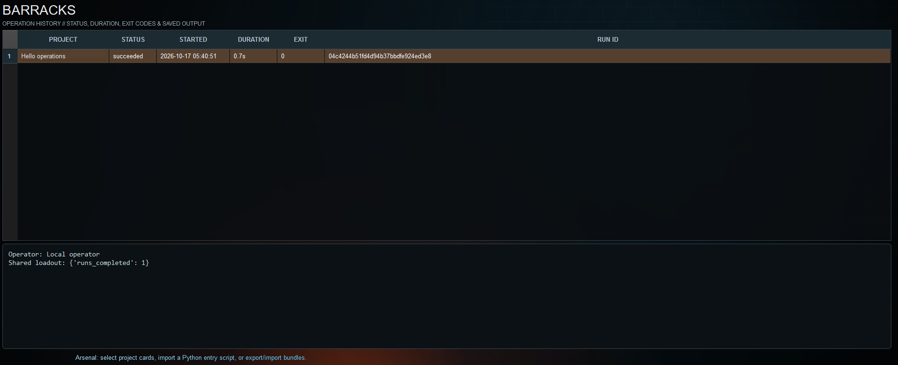

### Assets

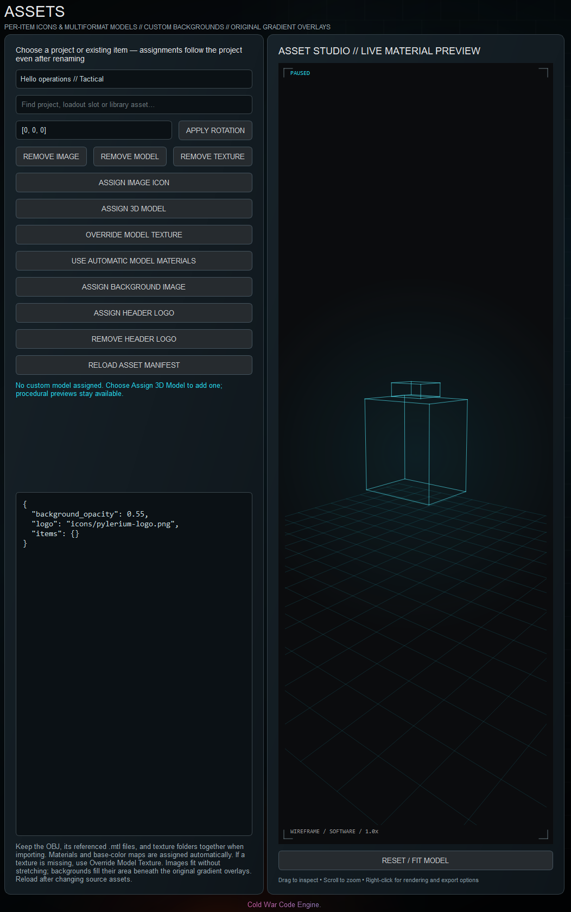

### Pylerium Studio

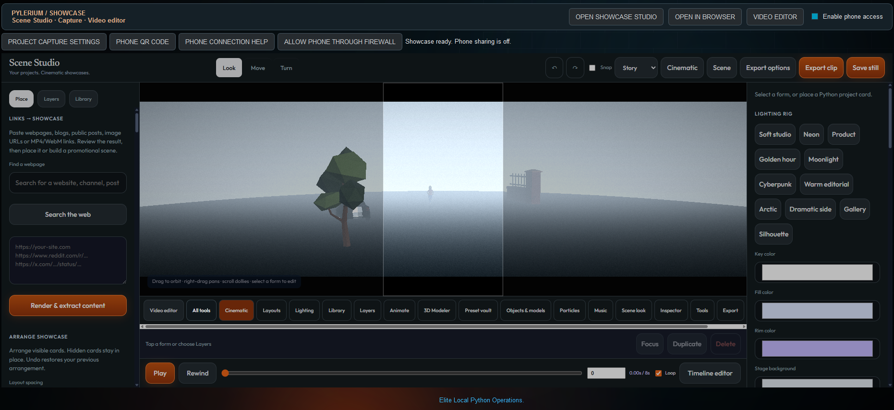

### Video Editor

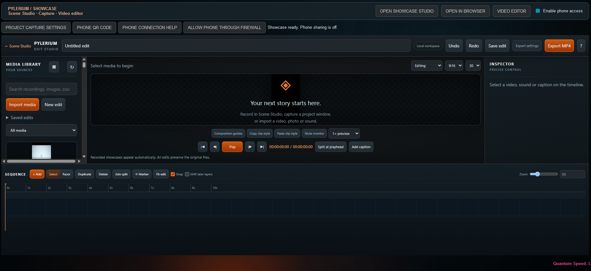

### Settings

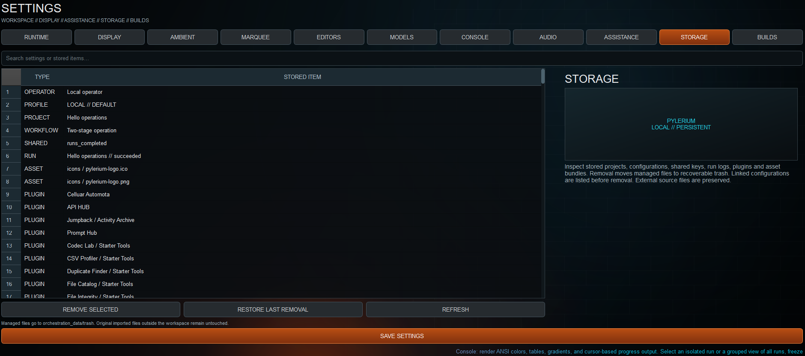

## Run from source (Windows)

Python 3.10 or newer is required; Python 3.13 is recommended for the Windows executable builder.

```powershell
python -m venv .venv
.\.venv\Scripts\python.exe -m pip install -r requirements.txt
.\.venv\Scripts\python.exe -m playwright install chromium
.\.venv\Scripts\python.exe orchestration-menu.py
```

Scene Studio webpage captures require the Playwright browser installed above. Video recording, audio extraction and MP4 export also require `ffmpeg` and `ffprobe` on PATH; verify with `ffmpeg -version` and `ffprobe -version`. The source release does not bundle an executable or FFmpeg.

The application creates a local `orchestration_data/` workspace on first use. Personal databases, project execution history, virtual environments, caches and generated executables are excluded from Git. Set `PYLERIUM_HOME` to select another workspace.

## Project execution loadouts

Click a project in **Arsenal** to configure its execution loadout. Primary opens the entry point and named argument attachments; use **Open Editor** to edit code and **Run Project** to execute it. Configure companion scripts, environment files, diagnostics, output reports, policies and pipeline overrides per project.

**Run Project does not build an executable.** Packaging is an explicit action in **Workshop → Build EXE**. Legacy C4/PyInstaller output hooks are disabled automatically.

Right-click an Arsenal project for loadout, editor, run, rename, duplicate, folder and asset actions. Assign an image or static 3D model to each execution card. The Assets studio provides model inspection, material overrides, rotation controls and removable assignments.

## Build something creative

Workshop and Plugin Builder include 12 creative experiences, 12 reusable UI elements and 6 additional boilerplates. Explore constellation networks, particles, waves, an orbital observatory, cellular life, mandalas, digital rain, terrain, a focus garden, branching stories, an idea board and color palettes. Templates are editable starting points; creating or inserting one does not enable a plugin automatically.

## Build a Windows executable

```powershell
.\.venv\Scripts\python.exe -m pip install -r requirements-build.txt
.\.venv\Scripts\python.exe build_exe.py
```

The icon picker appears when running the builder directly. Workshop also provides a configurable executable builder. Build output stays local in dist/ and build/.

## Guides

[Operations](OPERATIONS.md) · [Workshop](WORKSHOP.md) · [Plugins](PLUGINS.md) · [Executable builds](BUILD.md) · [Starter gallery](STARTER_TOOLS.md)

## Checks

```powershell
python -m unittest discover -s . -p "test_*.py"
```

Showcase Studio is integrated into the SHOWCASE workspace, with Workshop/plugin capture and optional phone sharing. See [SHOWCASE_INTEGRATION.md](SHOWCASE_INTEGRATION.md).

## Studio and editing

[Scene Studio](Promotional/SHOWCASE.md) · [40 vertical scenes](Promotional/VERTICAL_SCENES.md) · [Video editor and callouts](Promotional/VIDEO_EDITOR.md)

Desktop modules live at the repository root. The canonical Studio lives in `Promotional/`; run `python sync_showcase.py` after editing it to update the bundled `showcase_studio/` copy.
